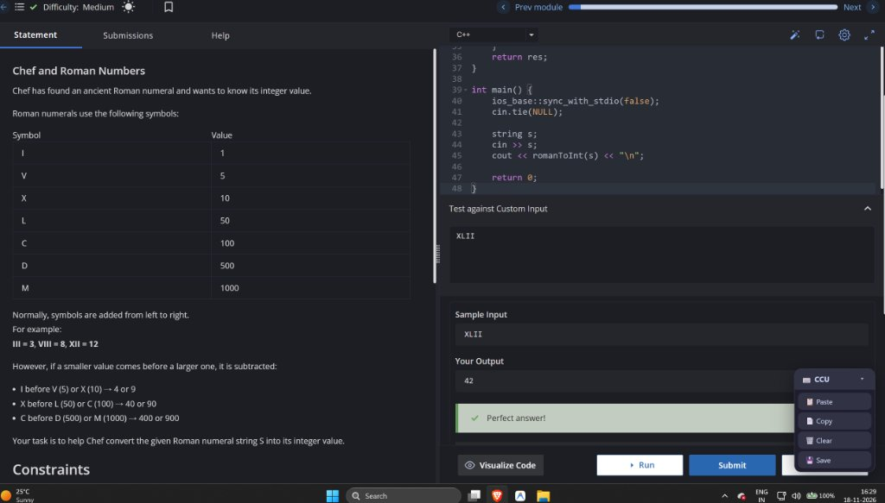
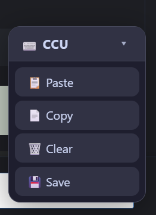

# 🔓 CodeChef Clipboard Unlock (CCU)

> **Effortlessly paste code into CodeChef's web editor without clipboard blocks or formatting glitches.**  
> Copy from ChatGPT, VS Code, or your local IDE ➔ Press `Alt + Shift + V` ➔ Done!



---

## ⚡ The Problem

CodeChef’s web interface uses a virtualized editor (built on **Monaco Editor**, the core of VS Code). Monaco intercepts native clipboard events and maintains internal state models rather than syncing with standard `<textarea>` elements. As a result:

- Traditional browser paste operations (`Ctrl + V`) often get ignored, blocked, or strip indentation.
- Generic "enable copy/paste" extensions fail because changing DOM textarea elements does not update Monaco's internal editor buffer.
- Switching between ChatGPT/local IDEs and practice problems becomes frustrating.

## 🚀 How It Works

**CodeChef Clipboard Unlock (CCU)** connects directly to the underlying Monaco Editor instance using its legitimate programmatic document update API (`executeEdits` / `getModel().getFullModelRange()`).

```javascript
// Reliable, non-destructive programmatic injection directly into Monaco
const model = editor.getModel();
editor.executeEdits('ccu-paste', [{
  range: model.getFullModelRange(),
  text: clipboardCode,
  forceMoveMarkers: true
}]);
```

- **Preserves all formatting**: Keeps tabs, spaces, newlines, and special characters intact.
- **Large snippet support**: Injects entire solutions instantaneously without lag.
- **Multi-editor fallback**: Automatic detection and support for **Monaco**, **CodeMirror (5 & 6)**, and **Ace Editor**.

---

## 🛠️ Features

<p align="center">
  
</p>

- 📋 **One-Click Paste**: Dedicated toolbar button and instant shortcut (`Alt + Shift + V`).
- 📄 **Copy Editor Code**: Quickly export or copy active code from the editor (`Alt + Shift + C`).
- 🗑️ **Clear Buffer**: Wipe the editor clean with a single click.
- 💾 **Local Solution Storage**: Save and bookmark working solutions locally linked to the problem URL (`Alt + Shift + S`).
- 🧰 **Floating & Draggable Toolbar**: Unobtrusive, dark-themed floating widget that can be moved or collapsed anywhere on the screen.
- 🔒 **100% Client-Side & Private**: No analytics, no remote servers, no background tracking, and no `eval()`.

---

## ⌨️ Default Keyboard Shortcuts

| Shortcut | Action |
| :--- | :--- |
| <kbd>Alt</kbd> + <kbd>Shift</kbd> + <kbd>V</kbd> | **Paste** clipboard content into editor |
| <kbd>Alt</kbd> + <kbd>Shift</kbd> + <kbd>C</kbd> | **Copy** editor content to clipboard |
| <kbd>Alt</kbd> + <kbd>Shift</kbd> + <kbd>S</kbd> | **Save** current solution locally |

> 💡 *Want custom keys? Go to `chrome://extensions/shortcuts` or `brave://extensions/shortcuts` to customize them anytime.*

---

## 📦 Installation Instructions

### For Google Chrome:
1. Clone or download this repository to your computer:
   ```bash
   git clone https://github.com/shauryamalhotra957-wq/codechef-clipboard-unlock.git
   ```
2. Open Chrome and navigate to:
   ```text
   chrome://extensions/
   ```
3. Enable **Developer mode** using the toggle switch in the top-right corner.
4. Click the **Load unpacked** button in the top-left corner.
5. Select the folder containing `manifest.json` (`codechef-clipboard-unlock`).
6. Open any [CodeChef Problem](https://www.codechef.com/problems/TEST) and start coding!

### For Brave Browser:
1. Open Brave and navigate to:
   ```text
   brave://extensions/
   ```
2. Enable **Developer mode** in the top-right corner.
3. Click **Load unpacked** and select the cloned extension directory.
4. Pin the extension to your toolbar for quick access.

---

## ⚠️ Important Disclaimer & Contest Warning

> [!WARNING]
> **FOR PRACTICE AND EDUCATIONAL PURPOSES ONLY**  
> This extension is created to streamline practice sessions, module learning, and local problem-solving on CodeChef.  
> 
> **DO NOT USE THIS EXTENSION DURING LIVE RATED CONTESTS.**  
> CodeChef employs active proctoring, anti-cheat detection, and behavior analysis during live competitive contests. Using browser extensions or automated clipboard tools during rated competitions violates CodeChef's Code of Conduct and can lead to immediate disqualification, rating drops, or account suspension.
> 
> The author assumes no responsibility for any consequences arising from misuse during competitive events.

---

## 📂 Project Structure

```text
codechef-clipboard-unlock/
├── manifest.json        # Manifest V3 configuration & permissions
├── background.js        # Background service worker & shortcut dispatching
├── content.js           # Content script with Monaco page-bridge & floating toolbar
├── toolbar.css          # Modern dark styling for the draggable toolbar & toasts
├── popup.html           # Extension popup interface
├── popup.css            # Extension popup dark theme stylesheet
├── popup.js             # Extension popup controller & solution manager
├── settings.html        # Options & preferences page
├── assets/              # Screenshots & documentation graphics
├── icons/               # 16px, 48px, and 128px extension icons
└── tests/
    └── TESTING.md       # Comprehensive testing matrix & verification guide
```

---

## 🛡️ Permissions & Security

This extension adheres to strict **Manifest V3** security standards:
- `storage`: For saving solution history locally on your device.
- `scripting`: To communicate securely with the tab context for clear/reset actions.
- `clipboardRead` & `clipboardWrite`: Required only to read text you explicitly paste and to copy editor code.
- `host_permissions`: Strictly scoped to `https://www.codechef.com/*`.

---

## 🤝 Contributing & Feedback

Contributions, feature requests, and bug reports are welcome! Feel free to open an issue or submit a pull request.

## 📄 License

Distributed under the [MIT License](LICENSE).
